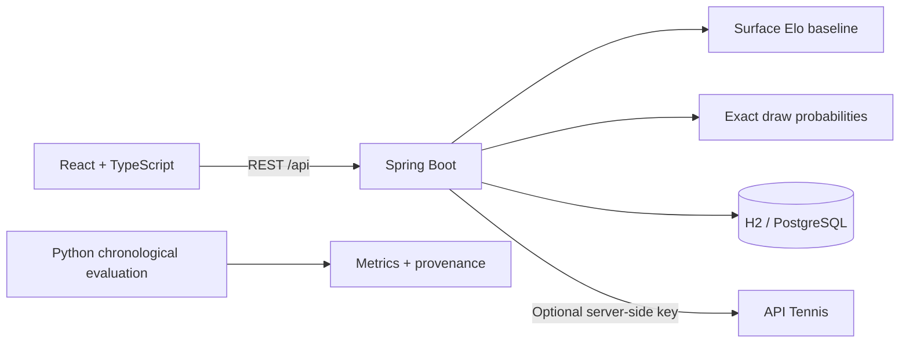

# PredicTenniz · CourtVision

**A tennis prediction lab: explore a draw, quantify uncertainty, estimate prize money.**

Portfolio project built with Java 21, Spring Boot, React, TypeScript and SQL. The first release is an end-to-end **Elo baseline**, not a trained ML system. Player ratings and prize schedules in the demo are explicitly illustrative, not current rankings or forecasts.

## What works in the first release

- Upload a JSON draw of 2, 4, 8, 16, 32 or 64 known players in bracket order.
- Change the court surface and calculate every player's probability of reaching each round.
- Calculate tournament win probability with exact dynamic programming, without simulation noise.
- Estimate gross prize money from a user-supplied payout schedule; this is not salary or net income.
- Compare two players and inspect the rating difference behind a prediction.
- Save and reload runs through a Spring Boot REST API and a SQL database.
- Optionally fetch fixtures from API Tennis using a server-side API key.

## Run locally

Prerequisites: **JDK 21**, Node.js 22.12+ and Python 3.11+ for the optional research workflow.

On Windows, from the repository root, run `./scripts/Start-Backend.ps1` and `./scripts/Start-Frontend.ps1` in two separate terminals. Leave them open while using the app; Ctrl+C stops each process. The backend script can locate a JDK 21 under `Program Files/Java`; otherwise set `JAVA_HOME`. Equivalent manual commands:

```powershell
# Terminal 1 (Windows)
cd backend
.\mvnw.cmd spring-boot:run

# Terminal 2
cd frontend
npm ci
npm run dev
```

Open **http://localhost:5173**. Vite proxies `/api` to **http://localhost:8080**. The default database is a local H2 file under `backend/data/`; no account, API key or Docker is needed. The app is intended for local use; authentication and rate limits are prerequisites for public deployment.

On macOS/Linux use `./mvnw spring-boot:run`. For PostgreSQL, run `docker compose up -d`, set `SPRING_PROFILES_ACTIVE=postgres`, and start the backend. Copy `.env.example` to `.env` for Docker settings; shell environment variables are needed when running Java outside Docker.

## Architecture



The demo works only with an available backend. A connection failure is shown as an error, never silently replaced with fabricated API results.

## API

| Method | Route | Purpose |
| --- | --- | --- |
| GET | `/api/players` | Illustrative player snapshots and surface ratings |
| POST | `/api/predictions` | Pairwise probability and explanation |
| POST | `/api/draws/preview` | Calculate a draw without persisting it |
| POST | `/api/simulations` | Validate a draw, calculate probabilities, persist the result |
| GET | `/api/simulations` | Last 20 saved runs |
| GET | `/api/simulations/{id}` | Reload a saved run |
| GET | `/api/integrations/status` | Whether a provider key is configured |
| GET | `/api/integrations/fixtures?date=2026-11-01` | Optional external API integration |
| GET | `/actuator/health` | Backend/database health |

Examples are in [docs/API.md](docs/API.md). The sample draw is in [examples/draw.json](examples/draw.json).

## Model honesty

For players A and B: `P(A wins) = 1 / (1 + 10 ** ((Elo_B - Elo_A) / 400))`.

This is a transparent baseline. The demo ratings are synthetic inputs and **have no claimed predictive accuracy**. It ignores injuries, fatigue, withdrawals, match format and time-varying form. Probabilities are conditional on every listed player participating. There are no byes or reseeding in v1. See [the model card](docs/MODEL_CARD.md) for assumptions, formulas and the path toward ML and DL.

## Learning and delivery

The [first historical experiment](docs/EXPERIMENT_001.md) compares 50%, global Elo and fitted logistic regression on 2,973 test matches from 2024. Elo achieved lower test log loss (0.62328) than logistic regression (0.62645). These scores describe offline research, not the dashboard's synthetic ratings. See [verification evidence](docs/VERIFICATION.md).

Read [LEARNING_PATH.md](docs/LEARNING_PATH.md) for small exercises and acceptance criteria. Read [DECISIONS.md](docs/DECISIONS.md) for engineering tradeoffs. Documentation is in English for portfolio readers; the learning guide is in Polish.

1. Foundation: project scope, architecture, reproducible local setup.
2. Backend: validated API, Elo, exact bracket engine, persistence, tests.
3. Frontend: interactive dashboard, file upload, saved runs, API integration.
4. Research: chronological historical evaluation with baselines and logistic regression.
5. Later: dataset-backed ratings, calibrated ML, optional DL experiment, production deployment.

Each completed stage is committed separately. Publishing commits requires a target GitHub repository and Git authentication.

## Verification

```powershell
cd backend
.\mvnw.cmd verify
cd ../frontend
npm ci
npm run build
npm test
cd ..
python -m unittest discover -s research/tests
```

## Data and licensing

The included demo player snapshots and payouts are illustrative values authored for this project. They are not copied ATP statistics. Historical research optionally uses Jeff Sackmann's tennis data, available through an [archival mirror](https://github.com/Aneeshers/tennis-sackmann-archive). Those datasets are **CC BY-NC-SA 4.0**; see [DATA_SOURCES.md](docs/DATA_SOURCES.md). Downloaded data and derived research outputs are excluded from Git by default. No project-wide code license has been selected.

This project demonstrates engineering and statistical reasoning. It does not claim an investment edge, betting profit or verified live forecasting performance.
