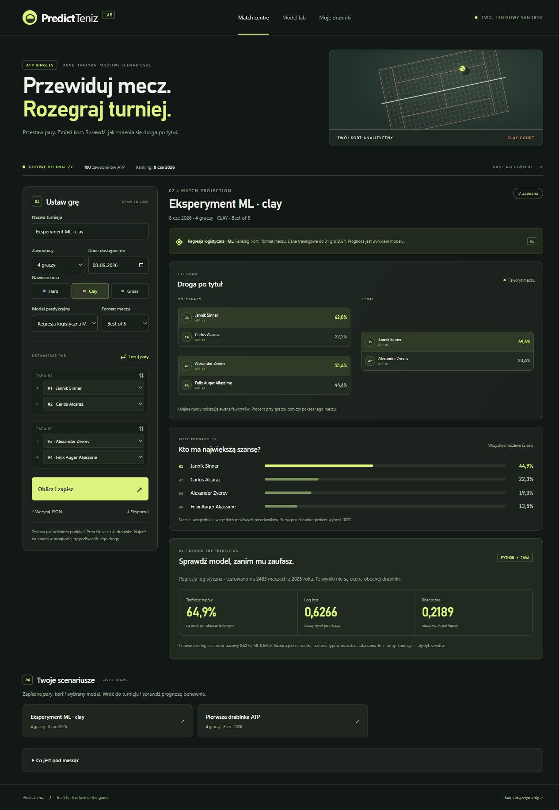

# PredictTeniz

Lokalna aplikacja do analizy drabinek tenisowych: wybierz zawodników ATP, ustaw pary, sprawdź przewidywany przebieg rund i szanse na tytuł. Zapisane drabinki trafiają do PostgreSQL; można je ponownie otwierać oraz importować i eksportować jako JSON.

Projekt rozwijany krok po kroku w IntelliJ. Aktualny kod znajduje się na **main**. Wcześniejszy prototyp pozostaje w historii Git; folderem roboczym jest projekt `PredictTeniz` z głównym `pom.xml`.

## Co już działa

- Import profili i najnowszego snapshotu rankingu z przypiętego archiwum CSV.
- Dashboard pod `/`: ciemny tenisowy interfejs, drabinki 2/4/8/16 zawodników, losowanie par, podświetlanie drogi gracza i animowane przeliczanie szans. Animacje respektują ograniczenie ruchu w systemie.
- Prognozy pojedynczych meczów i obliczanie szans na tytuł ze wszystkich możliwych ścieżek.
- Zapis kolejności par, daty danych, nawierzchni, formatu meczu i wersji modelu; ponowny odczyt i import/eksport JSON.
- Walidacja wejścia, jawne błędy brakujących rankingów, ochrona CSRF i migracje Flyway.

**Dostępne są dwa modele: heurystyka rankingowa i wytrenowana regresja logistyczna ML.** Możesz zmieniać nawierzchnię i format meczu. [Moduł Pythona](ml/README.md) opisuje trening, test na osobnym sezonie i ograniczenia wyników. Próbka przygotowana z archiwum ma datę **2026-06-08**, a nie dzisiejszy ranking. Rozpoznawanie zdjęć/PDF drabinek, forma, nagrody pieniężne oraz sieci neuronowe są kolejnymi etapami.

<details>
<summary>Podgląd dashboardu i Model Lab</summary>



</details>
## Uruchomienie

Wymagane: JDK 25+, Docker Desktop oraz dostęp do internetu przy pierwszym pobraniu zależności i danych. Frontend jest częścią Spring Boot; nie wymaga osobnego serwera ani Node.js.

1. Otwórz folder zawierający ten `pom.xml` jako projekt Maven w IntelliJ i ustaw JDK.
2. Skopiuj `.env.example` do `.env`, ustaw lokalne hasło PostgreSQL i uruchom Docker Desktop.
3. Dla pustej bazy wykonaj import danych opisany poniżej. W istniejącej bazie import można powtarzać — istniejące identyfikatory i obserwacje rankingu są pomijane.
4. Uruchom `PredictTenizApplication` w IntelliJ i otwórz **http://localhost:8080/**.

Spring Boot uruchamia PostgreSQL przez `compose.yaml`. Baza udostępnia lokalny port 5434, aplikacja 8080. Jeżeli uruchamiasz Maven w terminalu, `JAVA_HOME` musi wskazywać JDK.

### Pierwszy import danych — PowerShell

Uruchom polecenia w głównym folderze projektu:

```powershell
./scripts/Prepare-PlayerData.ps1
$manifest = Get-Content target/import/players-top100.manifest.json | ConvertFrom-Json
$jvm = '-Dspring-boot.run.jvmArguments=-Dspring.devtools.restart.enabled=false'
$profiles = '-Dspring-boot.run.arguments=--spring.profiles.active=player-import --tennis.import.players.path=target/import/players-top100.csv --tennis.import.players.sha256={0} --server.port=0' -f $manifest.selectedCsvSha256
./mvnw.cmd spring-boot:run $jvm $profiles
$rankings = '-Dspring-boot.run.arguments=--spring.profiles.active=ranking-import --tennis.import.rankings.path=target/import/atp_rankings_current.csv --tennis.import.rankings.sha256={0} --server.port=0' -f $manifest.rankingsSha256
./mvnw.cmd spring-boot:run $jvm $rankings
```

Każdy importer kończy pracę po wypisaniu podsumowania. Następnie uruchom aplikację normalnie, bez profilu importu. Na macOS/Linux użyj `./mvnw` i równoważnych argumentów oraz przygotowanego CSV. Dane i manifesty w `target/import` nie są dodawane do Git.

## Architektura i nauka

[Opis modułów, przepływu żądania i modelu](docs/ARCHITECTURE.md) wyjaśnia, co odpowiada za każdy krok. [Pochodzenie danych](docs/PLAYER_IMPORT.md) dokumentuje profile i zewnętrzne warunki korzystania z danych.

Technologie: Java, Spring Boot MVC, Thymeleaf, JavaScript, Spring Data JPA, PostgreSQL, Flyway, Spring Security, Docker Compose, JUnit i MockMvc. Jest to jeden modularny backend z lokalnym frontendem.

## Testy

```powershell
./mvnw.cmd test
```

Docker Desktop musi działać. Testy bazodanowe korzystają z oddzielnego schematu `player_entity_test`, a rekordy testowe są wycofywane. Nie dodają fikcyjnych graczy ani turniejów do schematu aplikacji.

Testy sprawdzają m.in. import bez duplikatów, brak użycia przyszłych rankingów, normalizację szans w drabince, alternatywnych przeciwników w finale, zachowanie kolejności po zapisie, walidację API i CSRF.

## Następny krok badawczy

Rozszerzyć istniejący eksperyment o Elo i formę wyliczaną bez przyszłych wyników. Obecny ML ma nieznacznie niższy log loss od heurystyki na 2483 testowych meczach z 2025 roku, przy tej samej trafności 64.9%. Nie traktujemy tego jako potwierdzenia skuteczności na bieżących meczach. Wyniki i sposób odtworzenia eksperymentu: [ml/README.md](ml/README.md).
