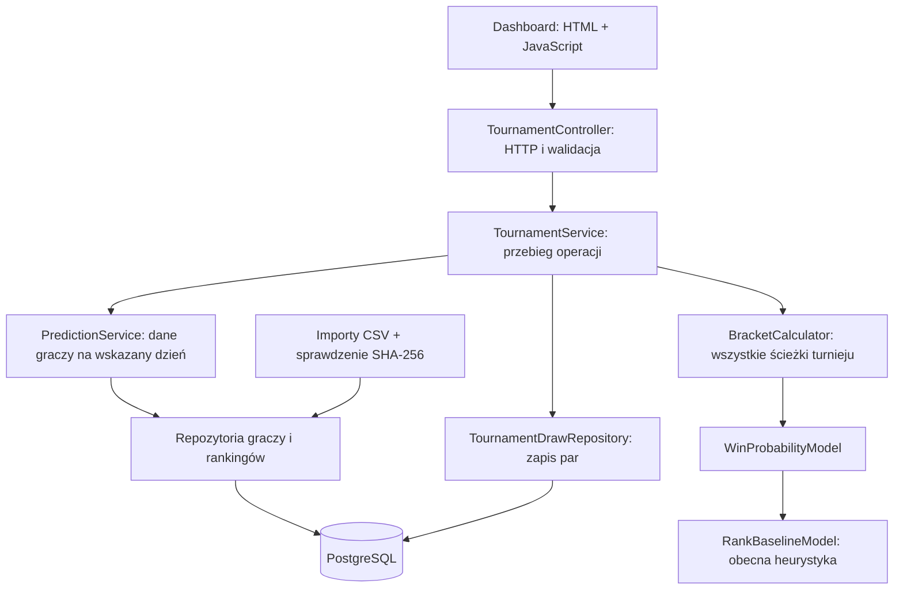

# Jak działa PredictTeniz

Jedna aplikacja Spring Boot, jedna baza PostgreSQL i frontend serwowany z tego samego adresu. Moduły są podzielone według funkcji. Nie uruchamiamy jeszcze osobnych mikroserwisów: na tym etapie utrudniłyby śledzenie przepływu i lokalne uruchamianie.

## Odpowiedzialności

| Miejsce | Za co odpowiada |
|---|---|
| `dashboard/DashboardController` | Zwraca szablon strony. Thymeleaf dodaje token do ochrony żądań formularza. |
| `templates/dashboard.html` | Układ strony, formularze i czytelne informacje o ograniczeniach modelu. |
| `static/assets/dashboard.js` | Wywołuje API, wyświetla wyniki, obsługuje pliki JSON. Nie oblicza szans. |
| `tournament/TournamentController` | Przyjmuje HTTP/JSON, sprawdza format i zwraca odpowiedź HTTP. |
| `tournament/TournamentService` | Łączy pobranie danych, obliczenie prognozy i opcjonalny zapis w transakcji. |
| `prediction/PredictionService` | Dobiera ostatni ranking ATP z datą nie późniejszą niż `asOf`. Brak rankingu daje błąd 422. |
| `prediction/WinProbabilityModel` | Kontrakt modelu pojedynczego meczu. Silnik turnieju nie musi znać użytego wzoru. |
| `tournament/BracketCalculator` | Propaguje rozkłady możliwych zwycięzców przez kolejne rundy. |
| `player/*Repository` | Odczyt i zapis encji przez JPA. |
| `db/migration` | Wersjonowane zmiany struktury bazy wykonywane przez Flyway. |
| `player/importing` | Pobranie przygotowanych plików, walidacja i zapis rekordów. Import jest uruchamiany świadomie profilem. |

`Controller` jest wejściem do aplikacji, `Service` wykonuje operację, `Repository` komunikuje się z bazą, a `Entity` opisuje zapisany obiekt. Tomcat obsługuje HTTP i kieruje żądanie do Spring MVC. Docker uruchamia obecnie PostgreSQL; kod Javy działa z IntelliJ lub Mavena.

## Co dzieje się po zmianie par

1. JavaScript wysyła `POST /api/tournaments/preview` z nazwą, datą danych i identyfikatorami graczy w kolejności miejsc.
2. Backend odrzuca duplikaty, niedozwoloną liczbę graczy, przyszłą datę analizy lub brakujące rankingi.
3. `PredictionService` pobiera pozycje. Użycie rankingu opublikowanego po dacie analizy byłoby wyciekiem przyszłej informacji do historycznej prognozy.
4. Model oblicza szanse spotkań, a silnik drabinki oblicza szanse awansu.
5. Odpowiedź zawiera prognozowaną ścieżkę i osobne szanse na tytuł dla wszystkich graczy. Podgląd nie zapisuje nic w bazie.
6. `POST /api/tournaments` wykonuje te same obliczenia i dodatkowo zapisuje drabinkę. `GET /api/tournaments/{id}` ją ponownie otwiera.

`GET /api/tournaments/players?asOf=2026-06-08` udostępnia graczy z dostępnym rankingiem, jego datę i wersję modelu. `GET /api/tournaments` zwraca ostatnie 20 zapisanych drabinek.

## Model bazowy i drabinka

Obecnie `P(A wygrywa) = sqrt(rankB) / (sqrt(rankA) + sqrt(rankB))`. Równe pozycje dają 50%; pozycja 1 przeciwko 16 daje 80%. Wykładnik 0.5 jest ustaloną regułą, a nie parametrem wyuczonym na meczach. Model nie jest jeszcze skalibrowany ani oceniony na zbiorze testowym.

Wizualna ścieżka wybiera faworyta każdego spotkania; przy remisie wybieramy zawodnika z pierwszego miejsca pary. To przykładowy wariant. Szanse na tytuł liczymy osobno, sumując wszystkie możliwe spotkania. Przy czterech równych zawodnikach każdy otrzymuje 25%, a suma dla całego turnieju wynosi 100% przed zaokrągleniem. Są to dokładne obliczenia **w ramach przyjętego modelu**, przy stałej sile zawodnika i niezależności wyników warunkowej względem tych sił.

Na późniejszy ML/DL jest miejsce za kontraktem `WinProbabilityModel`. Gdy dojdą nawierzchnia i forma, kontrakt rozszerzymy o zestaw cech meczu. Nie tworzymy teraz pozornego modelu uczonego bez danych o wynikach.

## Baza i powtarzalność

- `players`: profile.
- `player_external_ids`: połączenie lokalnego gracza z identyfikatorem źródła, bez dopasowywania po nazwisku.
- `player_rankings`: obserwacje rankingów z datą i źródłem.
- `tournament_draws`: nazwa, data analizy, czas utworzenia i UUID drabinki.
- `tournament_entries`: dokładna kolejność miejsc i referencje do graczy.

Zapisujemy ustawienie turnieju, a prognozę przeliczamy przy odczycie. Uzupełnienie starszych rankingów lub zmiana modelu może zmienić wynik. Pełny audyt historycznych prognoz będzie wymagał osobnych snapshotów cech, wersji modelu i wyniku obliczenia; obecna wersja jeszcze tego nie obiecuje.

PostgreSQL działa w Dockerze z trwałym wolumenem. Testy używają osobnego schematu. `open-in-view=false` oznacza, że dane do odpowiedzi przygotowujemy w serwisie, a nie dociągamy ich podczas rysowania strony. Spring Modulith Core pozostaje do organizacji kodu; nie włączamy trwałej kolejki zdarzeń, której jeszcze nie używamy.

## Format drabinki JSON

Najłatwiej wyeksportować plik przyciskiem na stronie i potem go wczytać. Format ma pola `title`, `asOf` (YYYY-MM-DD) i `playerIds` (lista 2/4/8/16 różnych lokalnych identyfikatorów). Miejsca 1–2 tworzą pierwszą parę, 3–4 drugą itd. Identyfikatory muszą istnieć w tej bazie i mieć ranking na wskazany dzień. Import plików nie wysyła ich do zewnętrznej usługi. Zdjęcia/PDF oraz oficjalne formaty drabinek wymagają osobnych parserów.
