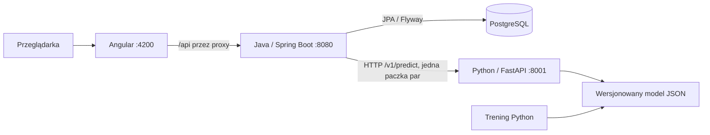

# Architektura PredictTeniz

Trzy niezależnie uruchamiane aplikacje, jedno repozytorium. Spring Boot nadal jest jednym backendem; Python jest oddzielną usługą ML. Angular nie zawiera reguł predykcji.

## Od kliknięcia do prognozy

1. Angular wysyła kolejność zawodników, datę danych, nawierzchnię, format i wersję modelu. Przy zmianach formularza opóźnia zapytanie o 180 ms i anuluje nieaktualny podgląd.
2. Spring sprawdza wejście i pobiera profile oraz najnowsze rankingi dostępne do wskazanej daty. Nie korzysta z rankingów z przyszłości. Identyfikatory bazy pozostają oddzielone od identyfikatorów źródła danych.
3. `PredictionModels` przygotowuje wszystkie nieuporządkowane pary: dla 16 graczy jest ich 120. Jedno zapytanie do Pythona zwraca kompletną macierz prawdopodobieństw.
4. Python waliduje kontrakt i datę treningu, a potem wykonuje wskazany model. Nie zna hasła ani tabel bazy Javy.
5. `CachedPairModel` sprawdza kompletność odpowiedzi, unikalność par i sumy prawdopodobieństw. `BracketCalculator` wylicza szanse na tytuł ze wszystkich możliwych rywali. Pokazana ścieżka faworytów jest osobnym uproszczonym widokiem.
6. Dopiero po prawidłowej prognozie zapisujemy definicję turnieju. `TournamentDrawStore` otwiera transakcję tylko na czas odczytu/zapisu — nie utrzymuje jej podczas czekania na HTTP. `@Version` i warunek wersji chronią przed utratą cudzych zmian.

## Granice awarii

Klient ML ma limit połączenia 2 s i odczytu 5 s. Niedostępność Pythona daje jawny błąd 503 dla nowej prognozy. Odczyt zapisanej definicji zwraca jej ustawienia nawet przy awarii ML; prognoza ma wtedy wartość null i komunikat błędu. Nie podmieniamy modelu bez wiedzy użytkownika. Połączenie HTTP może zostać ponowione przez użytkownika; zapisów nie ponawiamy automatycznie po błędzie sieci.

Angular najpierw pobiera token `/api/session`, potem przesyła go w nagłówku zapisów. Proxy deweloperskie i Nginx Dockera zachowują jedną domenę. CSRF pozostaje włączone. To lokalny projekt bez kont użytkowników; dostęp do API turniejów jest publiczny na lokalnych portach. Wersja internetowa wymaga osobnego projektu uwierzytelniania i własności danych.

## Co rozwijać w którym miejscu

- `frontend/src/app/pages`: interfejs i stan formularzy; `core/api.ts`: komunikacja ze Springiem.
- `src/main/java/.../player`: profile i import; `prediction`: przygotowanie wejścia i klient ML; `tournament`: zapis i matematyka drabinki.
- `ml/service`: walidacja i wykonywanie modeli. `ml/artifacts`: zatwierdzone modele. `ml/train.py`: odtwarzalny eksperyment. `ml/history_features.py`: następny etap badań nad historią.
- `contracts/ml-openapi.json`: jawna granica Java–Python. Generowanie: `python -m ml.service.export_contract`.
- `compose.yaml`: wspólne uruchamianie; osobny Dockerfile każdej aplikacji.

Lombok generuje konstruktory wstrzykujące zależności i gettery encji. Encje nie używają `@Data`; zachowują jawne operacje biznesowe i ochronę kolekcji przed modyfikacją z zewnątrz.

Komunikacja jest obecnie synchroniczna, ponieważ użytkownik oczekuje od razu wyniku drabinki. Broker zdarzeń będzie uzasadniony przy długim imporcie lub treningu w tle. Nie jest potrzebny do pojedynczej prognozy.
